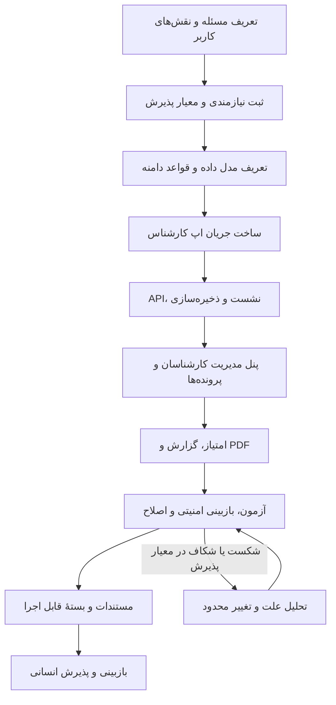

# روند ساخت اتو ال‌ام با کمک هوش مصنوعی

## خلاصهٔ پروژه

اتو ال‌ام یک سامانهٔ فارسی و راست‌به‌چپ برای ثبت کارشناسی خودرو و مدیریت پرونده‌هاست. محصول دو رابط دارد: اپ کارشناس برای ثبت و ادامهٔ کارشناسی، و پنل مدیریت برای ساخت حساب کارشناس، پیگیری پرونده‌ها و دیدن گزارش‌ها. داده از API هم‌مبدأ عبور می‌کند؛ اجرای محلی در SQLite ذخیره می‌کند و استقرار ابری از Vercel و Supabase استفاده می‌کند.

در توسعهٔ پروژه، از AI به‌عنوان دستیار مهندسی برای کاوش کد، تبدیل نیاز محصول به تغییر محدود، پیاده‌سازی، تحلیل آزمون‌ها و نگارش مستندات استفاده می‌شود. قواعد کسب‌وکار، تجربهٔ نهایی کاربر، پذیرش ریسک و تأیید تحویل تصمیم انسانی باقی می‌مانند. مراحل این سند ترتیب منطقی ساخت بر اساس وابستگی اجزای موجود را نشان می‌دهند؛ فایل‌ها تاریخچهٔ کامل گفت‌وگوهای AI را نگه نمی‌دارند.

## مسیر ساخت محصول



### ۱. مسئله و قرارداد محصول

ساخت از تعیین مخاطب‌ها و مرز محصول شروع شد: کارشناس باید پروندهٔ خودرو را مرحله‌به‌مرحله ثبت و ادامه دهد؛ مدیر باید کارشناسان و پرونده‌ها را از پنل مدیریت کند. پیش از افزودن رابط‌ها، محدودیت‌های اصلی محصول باید روشن باشند: فرم شامل ۱۶ مورد مشخص است؛ مورد بی‌پاسخ «بررسی‌نشده» می‌ماند؛ امتیاز کامل فقط بعد از پاسخ معتبر به همهٔ موارد ساخته می‌شود؛ و گزارش جای بازدید حضوری یا گواهی ایمنی نیست.

AI در این مرحله به مرتب‌کردن نیازها در قالب PRD، نقش‌ها، موارد خارج از دامنه و معیار پذیرش کمک می‌کند. صاحب محصول متن نهایی رفتارها و حدود ادعاهای گزارش را تأیید می‌کند. [PRD](PRD.md) حاصل این مرحله است.

### ۲. مدل دامنه و قرارداد داده

پیش از تکمیل صفحه‌ها، مدل مشترک پرونده، کارشناس، وضعیت هر مورد و مالکیت پرونده تثبیت شد. یک پرونده شناسه، مالک، مشخصات خودرو، ۱۶ وضعیت، یادداشت‌ها، مرحله و نسخهٔ ذخیره‌شده دارد. منطق پاک‌سازی، وضعیت تکمیل، امتیاز و هشدار ساختاری در [`admin/domain.js`](../admin/domain.js) متمرکز است تا اپ و پنل از تعریف‌های جدا و متناقض استفاده نکنند.

تصمیم‌های دامنه‌ای که باید در تمام تغییرها حفظ شوند:

- سالم ۱۰۰، نیاز به بررسی ۵۰ و معیوب صفر امتیاز دارد.
- وزن موتور ۳۵٪، بدنه ۳۰٪، داخل کابین ۲۰٪ و لاستیک‌ها ۱۵٪ است.
- نبود یا نامعتبر بودن هر پاسخ امتیاز کل را متوقف می‌کند؛ دادهٔ گمشده سالم فرض نمی‌شود.
- وضعیت شاسی و ستون‌ها علاوه بر امتیاز معمول، هشدار ساختاری مستقل دارد.

منطق کامل و مثال‌های محاسباتی در [راهنمای امتیازدهی](SCORING.md) ثبت شده است.

### ۳. اپ کارشناس

رابط کارشناس برای استفادهٔ فارسی و راست‌به‌چپ طراحی شده است. جریان ثبت پنج بخش دارد: اطلاعات خودرو و چهار گروه بدنه، موتور، داخل کابین و لاستیک‌ها. رابط باید روی موبایل و دسکتاپ قابل استفاده باشد و در هر زمان وضعیت فعلی، موردهای باقی‌مانده و امکان ادامهٔ پیش‌نویس را روشن کند.

در [`app.js`](../app.js)، [`index.html`](../index.html) و [`style.css`](../style.css) رفتار فرم و نمایش رابط قرار دارد. قابلیت‌های اصلی‌ای که در ساخت این جریان تثبیت شدند عبارت‌اند از:

- ایجاد پیش‌نویس پس از اولین ورود داده و ادامهٔ آن پس از تازه‌سازی.
- ذخیرهٔ تغییرهای در انتظار تأیید سرور برای بازیابی در صورت قطع اتصال.
- نگهداری یادداشت تأییدنشده به‌عنوان پیش‌نویس جدا از متن منتشرشده در گزارش.
- تاریخچه با جست‌وجو، فیلتر وضعیت و دسترسی به پرونده‌های همان کارشناس.
- ناوبری مرحله‌ای، انتخاب پلاک فارسی، پشتیبانی از صفحه‌کلید و بازخورد خطا.

اصل مهندسی این بخش آن است که وضعیت رابط منبع نهایی مالکیت یا ذخیره‌سازی نیست. رابط تغییر را آماده می‌کند، API آن را اعتبارسنجی می‌کند و نسخهٔ پذیرفته‌شده را برمی‌گرداند.

### ۴. API، نشست و ذخیره‌سازی

پس از تعریف قرارداد رابط، API برای ورود، دریافت نشست، خروج، خواندن و ذخیرهٔ پرونده ساخته شد. [`backend/api.js`](../backend/api.js) مرز درخواست‌ها و مجوزها را کنترل می‌کند؛ [`backend/store.js`](../backend/store.js) پیاده‌سازی محلی SQLite است؛ [`server.js`](../server.js) سرو فایل‌ها و API محلی را انجام می‌دهد.

برای استقرار ابری، همان قرارداد API به Store مبتنی بر Supabase متصل است: [`backend/postgrest-store.js`](../backend/postgrest-store.js)، [`backend/vercel-handler.js`](../backend/vercel-handler.js) و migrationهای [`supabase/migrations/`](../supabase/migrations/) این مسیر را تعریف می‌کنند. جدا کردن قرارداد API از Store امکان می‌دهد اجرای محلی و ابری رفتار اصلی یکسانی داشته باشند.

تصمیم‌های امنیتی مهم در این مرحله:

- نشست مدیر و کارشناس نقش جدا دارد؛ کارشناس فقط پرونده‌های متعلق به نشست خود را می‌بیند یا تغییر می‌دهد.
- مالک پرونده از نشست معتبر سمت سرور تعیین می‌شود، نه از مقدار ارسالی مرورگر.
- گذرواژه به‌صورت hash نمک‌دار نگهداری می‌شود؛ کوکی نشست `HttpOnly` و `SameSite=Strict` است و نشست زمان انقضا دارد.
- payload در مرز API اعتبارسنجی می‌شود؛ درخواست‌های نوشتن مبدأ مجاز را بررسی می‌کنند.
- تغییر نسخهٔ قدیمی پرونده را بی‌صدا بازنویسی نمی‌کند؛ تعارض نسخه باید به رابط برگردد تا retry کنترل شود.

### ۵. پنل مدیریت

پنل از نیاز مدیر برای مدیریت عملیاتی ساخته شد، نه فقط نمایش یک داشبورد. در [`admin/`](../admin/) دو فضای اصلی وجود دارد:

- **کارشناسان:** ایجاد و ویرایش پروفایل، تنظیم وضعیت فعال/غیرفعال، جست‌وجو و فیلتر بر اساس وضعیت و شهر، صفحه‌بندی و دیدن پرونده‌های هر کارشناس.
- **پرونده‌ها:** جست‌وجوی خودرو و پلاک، فیلتر وضعیت یا کارشناس، مرتب‌سازی و صفحه‌بندی؛ جزئیات پرونده در تب‌های وضعیت، خودرو، بدنه، موتور، کابین، لاستیک و گزارش نمایش داده می‌شود.
- **عملیات و خروجی:** دانلود گزارش، چاپ نسخهٔ متنی، انتخاب چند ردیف و خروجی جدول. دادهٔ متنی باید به‌صورت متن بماند و نباید به فرمول Excel تبدیل شود.
- **دسترسی:** مجوز عملیات مدیریتی سمت API بررسی می‌شود؛ پنهان‌کردن دکمه در رابط به‌تنهایی کنترل امنیتی نیست.

AI می‌تواند ساخت جدول، وضعیت‌های خالی، فیلتر و فرم‌ها را سریع‌تر پیاده‌سازی کند؛ انسان باید به‌ویژه هم‌خوانی دادهٔ جدول با دیتابیس، نقش‌ها، خوانایی فارسی و رفتار موبایل را بازبینی کند.

### ۶. امتیاز و گزارش

پس از ثبت دامنه و رابط، گزارش بر اساس رکورد ذخیره‌شده ساخته می‌شود. امتیاز هر گروه میانگین چهار مورد آن است؛ امتیاز کل از وزن چهار گروه به دست می‌آید. گزارش ناقص امتیاز کل ندارد. یافتهٔ ساختاری شاسی در کنار امتیاز نمایش داده می‌شود تا عدد کلی آن را پنهان نکند.

در اپ کارشناس، [`admin/report.js`](../admin/report.js) صفحه‌های فارسی A4 را در مرورگر می‌سازد و فایل PDF را مستقیم دانلود می‌کند. پنل مدیریت مسیر چاپ متن گزارش را هم دارد. یادداشت پیش‌نویس نباید وارد گزارش شود؛ فقط متن تأییدشده منتشر می‌شود. این تفکیک باعث می‌شود گزارش کاربر، پنل و امتیاز به یک نسخه از پرونده متکی بمانند.

### ۷. آزمون و بازبینی

آزمون‌ها به رفتارهای حساس محصول و مرزهای داده تقسیم شده‌اند؛ از جمله محاسبهٔ امتیاز و وضعیت شاسی، ورود و نشست، مالکیت پرونده، ذخیره و بازیابی SQLite، تعارض نسخه، جست‌وجوی فارسی، خروجی Excel و ادامهٔ پیش‌نویس. آزمون‌های مخزن در [`tests/`](../tests/) قرار دارند و با `npm test` اجرا می‌شوند.

در بازبینی هر تغییر، علاوه بر مسیر موفق، مسیرهای شکست بررسی می‌شوند: گزارش ناقص، وضعیت نامعتبر، نشست منقضی، کارشناس غیرفعال، متن مخرب، شکست درخواست، نسخهٔ قدیمی و نبود دارایی تصویری برای PDF. خروجی آزمون باید از خود فرمان خوانده شود و نتیجه‌ای که اجرا نشده موفق اعلام نشود.

در آخرین بررسی نسخهٔ بسته‌بندی‌شدهٔ این پروژه، آزمون‌های اصلی مخزن **۱۰۰ از ۱۰۰** و آزمون‌های ZIP مستقل **۹۷ از ۹۷** موفق بودند. برای تغییرهای بعدی، شمار آزمون‌ها ممکن است عوض شود؛ معیار همان اجرای فعلی فرمان و ثبت خروجی واقعی است.

### ۸. مستندات و انتشار بسته

با تثبیت محصول، مستندات به همان اندازهٔ کد تحویل شدند: [PRD](PRD.md)، [TRD](TRD.md)، [راهنمای کاربر](USER_GUIDE.md)، [نمودارها](DIAGRAMS.md)، [نقشهٔ ذهنی](PROJECT_MAP.md) و [فرمول امتیاز](SCORING.md). این راهنما مسیر ساخت را ثبت می‌کند تا توسعهٔ بعدی بر تصمیم‌های واقعی پروژه تکیه کند.

بستهٔ [`auto-lm-core-project.zip`](../auto-lm-core-project.zip) اپ، API، پنل، آزمون‌ها و مستندات لازم برای نسخهٔ اصلی را دارد. پلاگین، مسیرهای یکپارچه‌سازی خارج از دامنه، secretها، دادهٔ runtime و وابستگی‌های نصب‌شده در آن قرار ندارند. نسخهٔ اصلی برای اجرا به نصب کتابخانهٔ خارجی نیاز ندارد.

## نقش AI و نقش صاحب محصول

| بخش کار | نقش AI | نقش انسان |
|---|---|---|
| کشف مخزن | یافتن فایل‌ها و دنبال‌کردن جریان بین رابط، API، Store و تست | تأیید مسئله و محدودهٔ مطلوب |
| طراحی | پیشنهاد راه‌حل کوچک سازگار با معماری موجود و روشن‌کردن فرضیات | انتخاب رفتار محصول، معیار امتیاز و trade-offهای تجربه |
| پیاده‌سازی | ویرایش کد، حفظ الگوهای مخزن و به‌روزرسانی تست/سند مرتبط | بازبینی diff و رد تغییر ناخواسته |
| کنترل کیفیت | اجرای آزمون، بررسی خطا و گزارش شواهد | تصمیم دربارهٔ کفایت آزمون و پذیرش ریسک |
| تحویل | همگام‌سازی مستندات، Mermaid و ZIP | تأیید بسته و تصمیم انتشار |

**قاعدهٔ پایان:** وجود کد به معنی پایان کار نیست. کار وقتی آمادهٔ تحویل است که رفتار پذیرفته‌شده، کنترل دسترسی، دادهٔ ناقص، مستندات و آزمون‌های مرتبط همگی با شواهد قابل بررسی باشند.

## نمونهٔ درخواست AI برای توسعهٔ پنل

```text
هدف: بهبود فیلتر فهرست پرونده‌ها در پنل مدیریت.
ابتدا جریان داده را از admin/admin.js تا backend/api.js و Store دنبال کن و تست‌های مرتبط را بخوان.
محدوده: فیلتر و نمایش پرونده‌های پنل؛ قواعد امتیاز، مالکیت و API ذخیره را تغییر نده.
حالت‌ها: دادهٔ خالی، جست‌وجوی فارسی/عربی، ترکیب فیلترها، صفحه‌بندی و حساب کارشناس غیرفعال.
قیود: حفظ RTL و دسترس‌پذیری، بدون وابستگی تازه؛ ورودی کاربر امن بماند.
معیار پذیرش: فیلترها با هم درست ترکیب شوند، نتایج صفحه‌بندی دقیق باشند و دسترسی کارشناس به پروندهٔ دیگر باز نشود.
آزمون: تست‌های مرتبط و npm test را اجرا کن؛ فقط خروجی واقعی را گزارش کن.
مستندات: اگر رفتار مدیر تغییر کرد، راهنمای کاربر و نمودار مرتبط را هم به‌روز کن.
تحویل: diff محدود، خلاصهٔ فایل‌ها، تست‌های اجراشده و ریسک باقی‌مانده.
```

## مبنای best practice

روش بالا اصول عمومی توسعهٔ نرم‌افزار با AI را در معماری واقعی اتو ال‌ام به‌کار می‌گیرد: شناخت کدبیس پیش از ویرایش، تعریف معیار موفقیت، تغییر کوچک و قابل بازبینی، آزمون رفتار، دستورهای مخزن و تفکیک پیشنهاد مدل از پذیرش انسانی. این اصول با راهنماهای رسمی [OpenAI برای کار با Codex](https://developers.openai.com/cookbook/examples/gpt-5/codex_prompting_guide)، [GitHub برای توسعهٔ مرحله‌ای با coding agent](https://docs.github.com/en/copilot/using-github-copilot/using-copilot-coding-agent-to-work-on-tasks/best-practices-for-using-copilot-to-work-on-tasks) و [Google برای تغییرهای کوچک و قابل بازبینی](https://google.github.io/eng-practices/review/developer/small-cls.html) هم‌راستا هستند.
