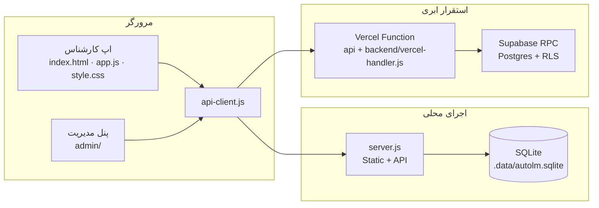
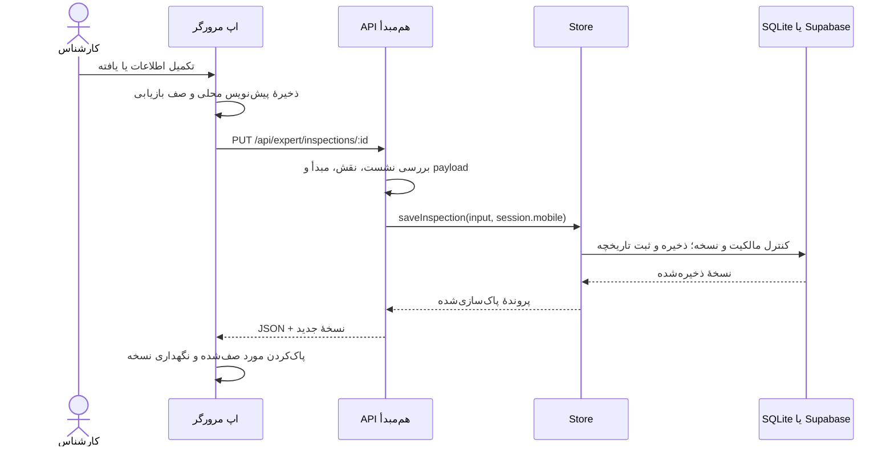
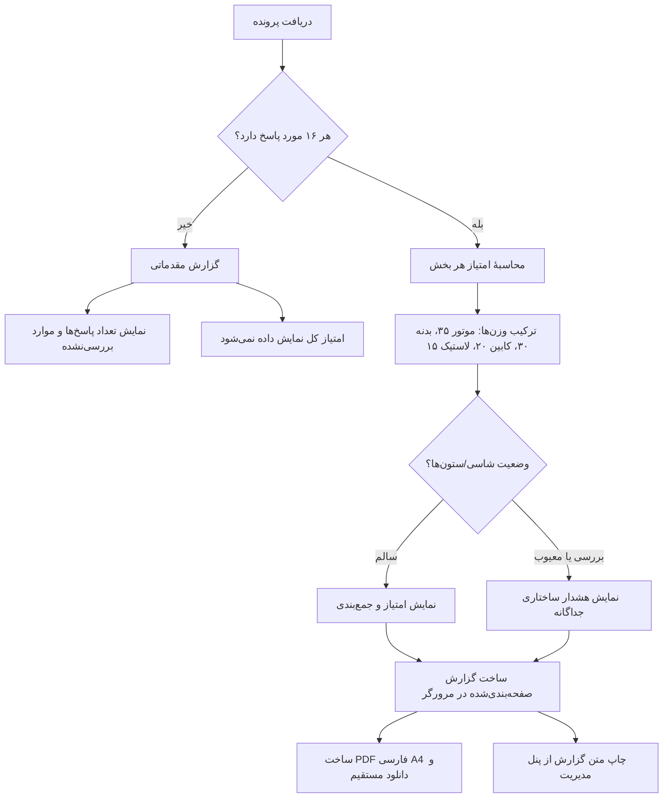

# TRD — طراحی فنی اتو ال‌ام

## ۱. نمای کلی

برنامه دو سطح رابط دارد: اپ کارشناس و پنل مدیر. کد رابط اصلی از HTML/CSS/JavaScript سبک ساخته شده است. درخواست‌ها به API هم‌مبدأ می‌روند. `server.js` در اجرای محلی فایل‌های رابط را سرو و API را روی SQLite اجرا می‌کند. در استقرار ابری، Vercel Function همان قرارداد API را به Store مبتنی بر Supabase متصل می‌کند.

## ۲. اجزای کد

| مسیر | مسئولیت |
|---|---|
| `app.js`, `index.html`, `style.css` | فرم کارشناس، تاریخچه، گزارش و رفتار مرورگر |
| `admin/` | پنل مدیر، فیلتر/صفحه‌بندی، جزئیات و خروجی Excel |
| `api-client.js` | درخواست JSON هم‌مبدأ و مهاجرت محدود دادهٔ قدیمی مرورگر |
| `server.js` | HTTP محلی، سرو فایل‌های مجاز، هدرهای امنیتی و SQLite |
| `backend/api.js` | احراز نشست، کنترل نقش، اعتبارسنجی مبدأ و مسیرهای API |
| `backend/store.js` | Store محلی، schema SQLite، نشست‌ها و سوابق تغییر |
| `backend/postgrest-store.js` | Store ابری با فراخوانی RPC در Supabase |
| `backend/vercel-handler.js` | اتصال Vercel Function به Store ابری |
| `admin/domain.js` | پاک‌سازی داده، قواعد وضعیت/امتیاز و توابع دامنهٔ مدیر |
| `supabase/migrations/` | ساخت schema ابری، سیاست دسترسی و RPC سمت پایگاه داده |
| `tests/` | آزمون‌های واحد، Store، API، جست‌وجو، همگام‌سازی کلاینت و گردش فرم |

پوشهٔ پلاگین در ZIP تحویلی نیست و هیچ‌یک از اجزای بالا برای اجرا به آن وابسته نیستند.

## ۳. جریان داده

### ذخیرهٔ کارشناسی

### گزارش و امتیاز

## ۴. مدل داده

### SQLite محلی

- `users`: شناسهٔ ورود، نقش، نام و هش رمز.
- `experts`: شماره موبایل، کد، نام، شهر، تخصص، وضعیت و اطلاعات پروفایل.
- `inspections`: شناسه، مالک، JSON خودرو، JSON موارد، مرحله، زمان‌ها، نسخه، وضعیت انتقال و metadata.
- `inspection_report_sources`: منشأ و تاریخچهٔ متن‌های تأییدشدهٔ گزارش.
- `sessions`: هش توکن نشست، نقش و زمان انقضا.
- `audit`: رویدادهای ایجاد، انتقال و تغییر وضعیت.

شمارهٔ موبایل به‌صورت رشته نگهداری می‌شود تا صفر آغازین حذف نشود. شناسهٔ گزارش پایدار است؛ ذخیرهٔ هم‌زمان با شمارهٔ نسخه انجام می‌شود.

### Supabase

تغییرات schema در `supabase/migrations/20261024000000_autolm_vercel_storage.sql` تعریف شده‌اند. دسترسی مستقیم نقش‌های عمومی به جدول‌ها بسته است، RLS فعال است و سرور از تابع RPC با توکن محدود به سرور استفاده می‌کند. مدل‌های اصلی مشابه SQLite هستند و ساختار audit و source هم حفظ می‌شود.

### قرارداد یک پرونده

هر پرونده شامل `id`, `ownerMobile`, `version`, `createdAt`, `updatedAt`, `step`, `vehicle` و `items` است. `items` کلیدهای ثابت دامنهٔ ۱۶ مورد را دارد؛ هر مورد `condition`, `note` و در مسیرهای پشتیبانی‌شده `noteDraft` می‌تواند داشته باشد. سمت سرور مقدار مالک را از نشست تعیین می‌کند و مقادیر مجاز وضعیت را دوباره بررسی می‌کند.

## ۵. API و کنترل دسترسی

| روش | مسیر | دسترسی / کار |
|---|---|---|
| `POST` | `/api/auth/login` | ورود مدیر یا کارشناس؛ کوکی HttpOnly |
| `GET` | `/api/auth/session?role=...` | اعتبارسنجی نشست و نقش |
| `POST` | `/api/auth/logout?role=...` | لغو نشست |
| `GET` | `/api/admin/overview` | مدیر؛ داده‌های کارشناسان و پرونده‌ها |
| `POST` | `/api/admin/experts` | مدیر؛ ایجاد کارشناس |
| `PUT` | `/api/admin/experts/:mobile` | مدیر؛ ویرایش کارشناس |
| `GET` | `/api/expert/inspections` | کارشناس؛ فقط پرونده‌های خودش |
| `PUT` | `/api/expert/inspections/:id` | کارشناس؛ ذخیره با کنترل مالکیت/نسخه |
| `POST` | `/api/admin/import`, `/api/expert/import` | انتقال محدود از نسخهٔ قدیمی |
| `GET` | `/api/health` | بررسی زنده‌بودن Function در استقرار |

نوشتن‌های متعارف فقط از مبدأ هم‌خوان و با نشست معتبر پذیرفته می‌شوند. نشست ۱۲ ساعت اعتبار دارد؛ کوکی `HttpOnly`, `SameSite=Strict` است و در production ویژگی `Secure` می‌گیرد. رمزها با scrypt و salt تصادفی ذخیره می‌شوند. هدرهای CSP، `X-Frame-Options`, `X-Content-Type-Options` و `Referrer-Policy` روی پاسخ‌ها اعمال می‌شوند.

## ۶. محیط اجرا و تنظیمات

### محلی

- Node.js `>=22.13.0`.
- `npm start`؛ درگاه پیش‌فرض `4173` و میزبان پیش‌فرض loopback است.
- پایگاه داده: `.data/autolm.sqlite`; قابل تغییر با `AUTOLM_DB_PATH`.
- درگاه: `PORT`؛ تنها بازهٔ 1024 تا 65535 پذیرفته می‌شود.
- `.env`, `.data`, `node_modules` و فایل‌های محیطی محلی از بستهٔ تحویلی خارج‌اند.
- اجرای عادی به نصب بستهٔ NPM برای اپ اصلی نیاز ندارد.

### ابری

- رابط و API روی Vercel Functions قرار دارند.
- Store ابری از `SUPABASE_URL`, `SUPABASE_ANON_KEY` و `AUTOLM_DB_API_TOKEN` استفاده می‌کند.
- هویت میزبان مجاز با `AUTOLM_ALLOWED_HOSTS`, `VERCEL_PROJECT_PRODUCTION_URL` و `VERCEL_URL` بررسی می‌شود.
- هویت اولیهٔ مدیر باید طبق فرایند استقرار امن در محیط production تنظیم شده باشد.

## ۷. آزمون و بررسی

- آزمون‌های اپ اصلی: `npm test` در ریشه.
- آزمون‌های مستقل ابزارهای API: `node --test tests/*.test.cjs` (همان فرمان `npm test`).
- اجرای مرورگرهای دستی/Playwright نیازمند Playwright و Chrome تنظیم‌شده است؛ راهنمای دقیق در README ریشه و فایل‌های `tests/*.browser.cjs` آمده است.
- ساخت/بررسی پوشهٔ پلاگین بخشی از بستهٔ ZIP نیست.

## ۸. محدودیت‌های طراحی

- SQLite ماژول `node:sqlite` در نسخهٔ لازم Node ممکن است هشدار experimental بدهد؛ در زمان اجرا از ماژول داخلی Node استفاده شده است.
- پیش‌نویس مرورگر نسخهٔ بازیابی و مهاجرت یک‌طرفه است؛ منبع اصلی داده در نشست معتبر، سرور است.
- PDF در مرورگر از صفحه‌های A4 رسم‌شده روی canvas و تصویرهای JPEG ساخته و مستقیم دانلود می‌شود؛ موتور PDF یا وابستگی خارجی در سرور لازم نیست. پنل مدیریت مسیر جداگانه‌ای برای چاپ نسخهٔ متنی گزارش دارد.
- فهرست خودروها برای پیشنهاد اولیه است و جامعیت همهٔ مدل‌ها را تضمین نمی‌کند.
